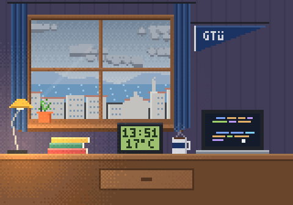

<h1 align="center">GTÜ Window</h1>

<p align="center">
  <a href="https://arif-aygun.github.io/gtu-window/">
    
  </a>
</p>

<p align="center">
  A pixel-art desk at Gebze Technical University. Its window shows <b>Gebze's real weather</b>:
  rain, snow, fog, clouds, thunderstorms and the <b>real phase of the moon</b>.
  <br>
  <a href="https://arif-aygun.github.io/gtu-window/"><b>Live page →</b></a>
</p>

## What it shows

- **Weather** from [Open-Meteo](https://open-meteo.com/), no API key needed. WMO weather codes map to clear, partly cloudy, overcast, fog, drizzle, rain, snow or thunderstorm.
- **Time of day** from today's sunrise and sunset in Gebze: dawn, day, dusk or night. The sun and moon move along their arc.
- **Moon phase**, calculated from the synodic month. Waxing moons are lit on the right and waning moons on the left, as seen from Türkiye.
- **The desk**: an LCD clock and thermometer showing Gebze time and temperature, a lamp that turns on after dark or under heavy cloud, and a mug that stops steaming when it's hot outside.
- **Wind**: clouds move faster above 25 km/h and rain falls at a slant.

## How it works

```
docs/js/weather.js   Open-Meteo → render state (pure, tested)
docs/js/moon.js      moon phase and terminator
docs/js/view.js      sky, sun/moon, clouds, Gulf of İzmit, rooftops, rain/snow/fog/lightning
docs/js/room.js      window frame, curtains, desk and everything on it
docs/js/scene.js     composes the scene and lights it (160×112 RGBA buffer)
docs/js/app.js       browser: fetch every 10 min, animate on a <canvas>
scripts/render-gif.mjs  Node: same renderer → 96-frame looping GIF
```

The renderer writes into a plain RGBA buffer with no DOM, so the **GitHub Pages site and the README GIF are drawn by the same code**. Every animation repeats exactly once per loop position `p ∈ [0, 1)`, so the GIF loops without a visible seam. A test checks this.

A GitHub Action runs every 30 minutes. It renders the GIF and force-pushes it to a single-commit `output` branch, so `main`'s history doesn't grow every time.

## Run it locally

```bash
npm install
npm test
npm run serve        # http://localhost:8080
npm run gif          # dist/window.gif with live weather
npm run gif -- snow night   # force a look
npm run preview      # preview/*.png: every condition × day/night/dusk
```

To force a look on the page, add URL parameters, e.g. `?condition=storm&phase=dusk`.
Conditions: `clear partly cloudy fog drizzle rain snow storm`. Phases: `dawn day dusk night`.

## Put it in your profile README

```html
<a href="https://arif-aygun.github.io/gtu-window/">
  
</a>
```

## Setup notes (forks)

1. **Settings → Pages**: deploy from branch `main`, folder `/docs`.
2. **Settings → Actions → General**: allow read and write workflow permissions.
3. GitHub pauses scheduled workflows after 60 days without repository activity. If the GIF stops updating, re-enable the workflow from the Actions tab.

## Credits

Weather data by [Open-Meteo.com](https://open-meteo.com/), licensed [CC BY 4.0](https://creativecommons.org/licenses/by/4.0/).
GIF encoding by [gifenc](https://github.com/mattdesl/gifenc). All art is drawn in code.
This is a personal project and is not affiliated with Gebze Technical University.

MIT licensed.
